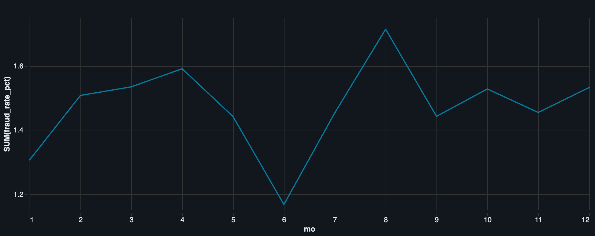
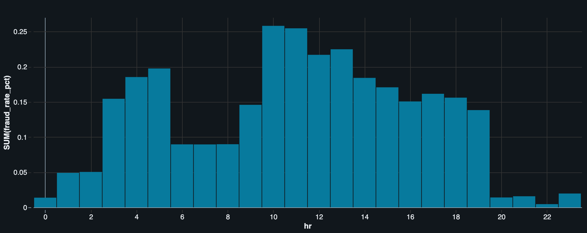
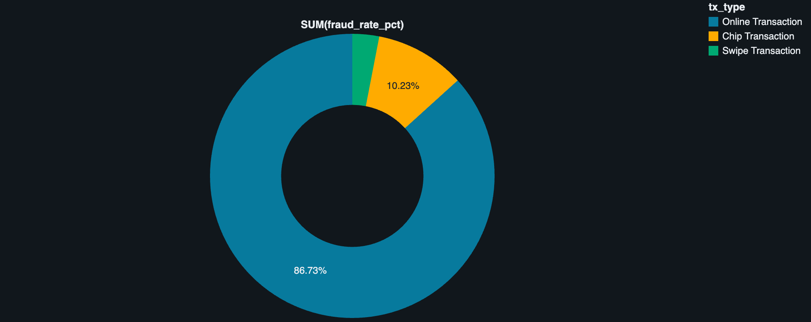
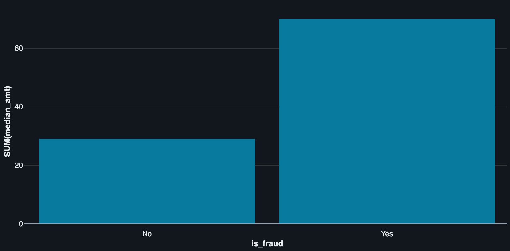

# Fraud Detection on Databricks

Fraud detection model for card transactions: build it from scratch in Databricks and assess whether a bank should use it.

**Tools:** Databricks (SQL, Python, MLflow, dashboards), GitHub.
**Data:** [Kaggle: Transactions Fraud Datasets](https://www.kaggle.com/datasets/computingvictor/transactions-fraud-datasets) (transactions, cards, users, fraud labels).

## Repository contents

| File | Description |
|---|---|
| `fraud_detection.ipynb` | Main notebook: setup, EDA, silver and gold tables, features. Later parts will be added here. |
| [`fraud_detection_1.csv`](fraud_detection_1.csv) | EDA, step 12: transaction amount statistics for fraud vs normal (source of the table below). |
| [`fraud_detection_2.csv`](fraud_detection_2.csv) | Part 3: check of `gold_fraud_features` (source of the table below). |
| `visualization_1.png` | Fraud rate by month of year. |
| `visualization_2.png` | Fraud rate by hour of day. |
| `visualization_3.png` | Fraud rate by transaction type. |
| `visualization_4.png` | Median transaction amount, fraud vs normal. |
| `README.md` | Project overview and results. |

## Progress

| Part | Topic | Status |
|---|---|---|
| 1 | Setup: GitHub and Databricks | Done |
| 2 | Load and explore the data (EDA) | Done |
| 3 | Clean tables and features in SQL | Done |
| 4 | Split the data by time | To do |
| 5 | Baseline model and metrics | To do |
| 6 | Choose the decision threshold | To do |
| 7 | Explain the model and present results | To do |

## Data layers (medallion pattern)

| Layer | Tables |
|---|---|
| Bronze | `pay_transactions`, `pay_cards`, `pay_users`, `pay_labels` |
| Silver | `silver_transactions`, `silver_cards`, `silver_users` |
| Gold | `gold_fraud_features` (one row per labelled transaction) |

## Results

### Part 2: EDA (full data, 2010-2019)

<table>
  <tr>
    <td> <em>Fraud rate by month of year.</em></td>
    <td> <em>Fraud rate by hour of day: peaks at 10:00-11:00 and 3:00-5:00, lowest in the evening (20:00-23:00).</em></td>
  </tr>
  <tr>
    <td> <em>Fraud rate by transaction type: online, chip and swipe.</em></td>
    <td> <em>Median transaction amount: about 70 for fraud vs about 29 for normal transactions.</em></td>
  </tr>
</table>

**Transaction amounts, fraud vs normal** (source: [`fraud_detection_1.csv`](fraud_detection_1.csv))

| is_fraud | n | mean_amt | median_amt | p95_amt | max_amt |
|---|---|---|---|---|---|
| Yes | 13,332 | 110.23 | 69.98 | 403.00 | 4,978.45 |
| No | 8,901,631 | 42.85 | 28.95 | 145.44 | 6,613.44 |

### Part 3: gold features

**Check of `gold_fraud_features`** (source: [`fraud_detection_2.csv`](fraud_detection_2.csv))

| n_rows | distinct_ids | n_fraud | n_first_tx |
|---|---|---|---|
| 8,914,963 | 8,914,963 | 13,332 | 812 |

One row per labelled transaction; `n_first_tx` is the number of first transactions of a client (no history yet).
