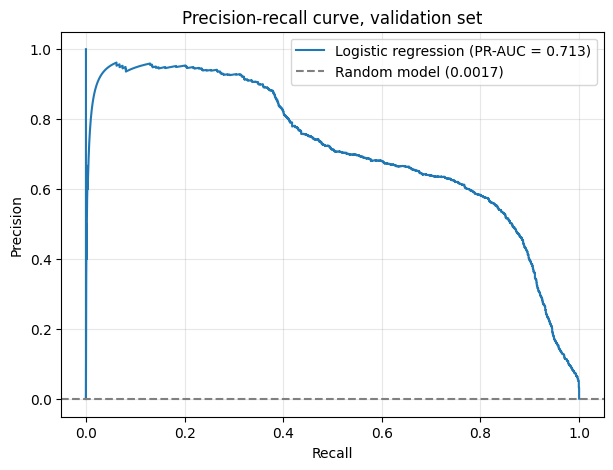

# Fraud Detection on Databricks

Fraud detection model for card transactions: build it from scratch in Databricks and assess whether a bank should use it.

**Tools:** Databricks (SQL, Python, MLflow, dashboards), GitHub.
**Data:** [Kaggle: Transactions Fraud Datasets](https://www.kaggle.com/datasets/computingvictor/transactions-fraud-datasets) (transactions, cards, users, fraud labels).

## Repository contents

| File | Description |
|---|---|
| `fraud_detection.ipynb` | Main notebook: setup, EDA, silver and gold tables, features, time split, baseline model. Later parts will be added here. |
| [`fraud_detection_1.csv`](fraud_detection_1.csv) | EDA, step 12: transaction amount statistics for fraud vs normal (source of the table below). |
| [`fraud_detection_2.csv`](fraud_detection_2.csv) | Part 3: check of `gold_fraud_features` (source of the table below). |
| `visualization_1.png` | Fraud rate by month of year. |
| `visualization_2.png` | Fraud rate by hour of day. |
| `visualization_3.png` | Fraud rate by transaction type. |
| `visualization_4.png` | Median transaction amount, fraud vs normal. |
| `Precision_recall_curve.png` | Part 5: precision-recall curve of the baseline model on the validation set. |
| `README.md` | Project overview and results. |

## Progress

| Part | Topic | Status |
|---|---|---|
| 1 | Setup: GitHub and Databricks | Done |
| 2 | Load and explore the data (EDA) | Done |
| 3 | Clean tables and features in SQL | Done |
| 4 | Split the data by time | Done |
| 5 | Baseline model and metrics | Done |
| 6 | Choose the decision threshold | To do |
| 7 | Explain the model and present results | To do |

## Data layers (medallion pattern)

| Layer | Tables |
|---|---|
| Bronze | `pay_transactions`, `pay_cards`, `pay_users`, `pay_labels` |
| Silver | `silver_transactions`, `silver_cards`, `silver_users` |
| Gold | `gold_fraud_features` (one row per labelled transaction), `gold_fraud_split` (same rows with a `split` column) |

## Results

### Part 2: EDA (full data, 2010-2019)

<table>
  <tr>
    <td> <em>Fraud rate by month of year.</em></td>
    <td> <em>Fraud rate by hour of day: peaks at 10:00-11:00 and 3:00-5:00, lowest in the evening (20:00-23:00).</em></td>
  </tr>
  <tr>
    <td> <em>Fraud rate by transaction type: online, chip and swipe.</em></td>
    <td> <em>Median transaction amount: about 70 for fraud vs about 29 for normal transactions.</em></td>
  </tr>
</table>

**Transaction amounts, fraud vs normal** (source: [`fraud_detection_1.csv`](fraud_detection_1.csv))

| is_fraud | n | mean_amt | median_amt | p95_amt | max_amt |
|---|---|---|---|---|---|
| Yes | 13,332 | 110.23 | 69.98 | 403.00 | 4,978.45 |
| No | 8,901,631 | 42.85 | 28.95 | 145.44 | 6,613.44 |

**Summary of Part 2**
- Replaced the transactions table (2010 only) with the full Kaggle file: 13.3M transactions, 2010-2019.
- 8,914,963 transactions have a fraud label; 13,332 are fraud (about 0.15%).
- Fraud rate changes by hour of day (peaks at 10:00-11:00 and 3:00-5:00).
- Fraud is larger than normal transactions: median amount about 70 vs 29.

### Part 3: tables and features

**Check of `gold_fraud_features`** (source: [`fraud_detection_2.csv`](fraud_detection_2.csv))

| n_rows | distinct_ids | n_fraud | n_first_tx |
|---|---|---|---|
| 8,914,963 | 8,914,963 | 13,332 | 812 |

One row per labelled transaction; `n_first_tx` is the number of first transactions of a client (no history yet).

**Summary of Part 3**
- Built three layers: silver (3 cleaned tables) and gold (`gold_fraud_features`).
- 21 main features and 5 reserve features; every history feature uses only data before the transaction (no leakage).
- Excluded: `card_type`, `gender`, current-snapshot columns (credit score, income, debt, dark web flag) and full-period aggregates from `client_insider`.

### Part 4: split by time

| Set | Period | Rows | Fraud | Fraud rate | Share of rows |
|---|---|---|---|---|---|
| Train | 2010-01-01 to 2017-12-31 | 7,203,025 | 10,343 | 0.14% | 80.8% |
| Validation | 2018 | 934,599 | 1,629 | 0.17% | 10.5% |
| Test | 2019-01-01 to 2019-10-31 | 777,339 | 1,360 | 0.18% | 8.7% |

**Summary of Part 4**
- Oldest data for training, newer for validation, newest for test: the model learns from the past and is checked on the future.
- Each set has enough fraud cases; the fraud rate in validation and test is close (0.17% and 0.18%).
- The fraud rate differs a lot between years (for example 0.004% in 2011 and 0.26% in 2016), so results depend on the period.
- The test set is used only once, at the very end.

### Part 5: baseline model

Logistic regression with `class_weight='balanced'` in a scikit-learn Pipeline (median imputer and standard scaler for numbers, one-hot encoder for categories), trained on the train set with the 21 main features. Metrics on the validation set, threshold 0.5. Runs are logged in MLflow.

| Metric | Baseline (21 features) | Without `mcc` and `merchant_state` |
|---|---|---|
| Frauds caught (TP) | 1,626 of 1,629 | 696 of 1,629 |
| False alarms (FP) | 27,214 | 85,879 |
| Recall | 0.998 | 0.427 |
| Precision | 0.056 | 0.008 |
| ROC-AUC | 0.9986 | 0.743 |
| PR-AUC | 0.713 | 0.008 |
| Alerts per caught fraud | 17.7 | 124.4 |

A random model has a PR-AUC equal to the fraud rate in validation (about 0.0017).

*Precision-recall curve on the validation set. Threshold 0.5 sits at the far right end (recall 0.998, precision 0.056).*

**Summary of Part 5**
- Accuracy is not used: with about 0.17% fraud, a model that always says "not fraud" is 99.8% accurate and catches nothing.
- At threshold 0.5 the baseline catches almost all fraud but raises many false alarms (about 17.7 alerts per real fraud). The threshold is chosen in Part 6.
- The results looked too good, so I investigated. The largest coefficients belong to `mcc` and `merchant_state`: for example Haiti has a 97.7% fraud rate in train, and several categories have none. Without these two features the model is weak (PR-AUC 0.008).
- The bank knows merchant category and location at the time of a transaction, so this is not a time leak, but the pattern may come from how the dataset was built and must be checked on real data.
- Limits: the solver did not converge in 200 iterations; the test set has not been used.
