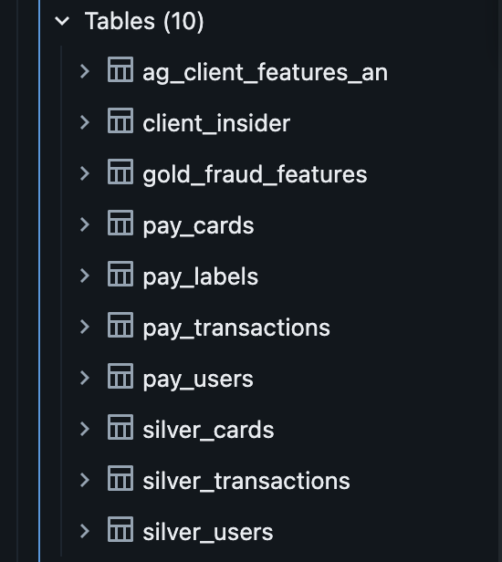

## Repository contents

| File | Description |
|---|---|
| `fraud_detection.ipynb` | Main notebook: EDA, silver and gold tables, features (Parts 2-3). Later parts will be added here. |
| `fraud_detection_1.csv` | <what is inside: e.g. sample rows of gold_fraud_features> |
| `fraud_detection_2.csv` | <what is inside> |
| `visualization_1.png` ... `visualization_4.png` | EDA charts (see below). |
| `fraud_detection_3.png` | <Part 3 screenshot: e.g. tables in Catalog or gold check> |
| `README.md` | Project overview, results and screenshots. |

## Results

### Part 2: EDA

*Fraud rate by month. The rate is not stable over time.*

*Fraud rate by hour of day. Fraud peaks at night (3:00-5:00).*

*Fraud rate by transaction type. Online transactions are far riskier than swipe.*

*Transaction amounts: fraudulent transactions are larger (median and p95).*

### Part 3: tables and features

*<caption: e.g. gold_fraud_features has 8,914,963 rows (one per labelled transaction), 13,332 fraud.>*
